# OpenLens: Multi-Agent System Architecture Diagram

> **OpenLens Multi-Agent Editorial Intelligence Engine**  
> Built with Google Agent Development Kit (ADK) on Vertex AI & Cloud Run.

---

## 1. System Agent Topology & Flow Diagram

This diagram maps the multi-agent graph, showing each specialized agent, its underlying Gemini model, its knowledge inputs, its deterministic guardrails, and its state outputs.

```mermaid
flowchart TD
    %% Styling Definitions
    classDef source fill:#f1f5f9,stroke:#475569,stroke-width:1.5px;
    classDef agentFlash fill:#e0f2fe,stroke:#0284c7,stroke-width:2px;
    classDef agentPro fill:#ede9fe,stroke:#7c3aed,stroke-width:2px;
    classDef guardrail fill:#fee2e2,stroke:#dc2626,stroke-width:2px;
    classDef state fill:#ecfdf5,stroke:#059669,stroke-width:2px;
    classDef human fill:#fef3c7,stroke:#d97706,stroke-width:2px;

    %% Source Ingestion
    subgraph S_Ingest ["Data Ingestion & Event Detection"]
        RawFeed["RSS / Atom Feeds & GDELT Signals\n(data/sources/feeds.json)"]:::source
        Allowlist[("Domain Allowlist & Rights DB\ndata/sources/allowlist.json")]:::source
        
        Agent_Intake["1. Intake & Document Agent\n(Cheerio Readability + Gemini Multimodal PDF)"]:::agentFlash
        Agent_Cluster["2. Clustering & Deduplication Agent\n(Model: gemini-embedding-2)"]:::agentFlash

        RawFeed & Allowlist --> Agent_Intake
        Agent_Intake --> Agent_Cluster
    end

    %% Agent Intelligence Pipeline
    subgraph S_CorePipeline ["Multi-Agent Evidence & Synthesis Graph (Google ADK)"]
        
        %% Stage 1: Claims
        Agent_Claims["3. Claim Extraction Agent\nModel: gemini-3.8-flash\nStructured JSON Mode"]:::agentFlash
        G_Quote{"Verbatim Offset Verifier\n(passageInSource())\nDrops unquoted assertions"}:::guardrail

        Agent_Cluster --> Agent_Claims
        Agent_Claims --> G_Quote

        %% Stage 2: Corroboration
        G_Quote -->|Valid Offsets| Agent_Corrob["4. Corroboration Engine\nModel: gemini-3.8-flash\n+ Deterministic Graph Clustering"]:::agentFlash
        G_Quote -.->|Quote Mismatch| DropClaim[/"Drop Claim (claimsDropped++)"/]

        %% Stage 3 & 4: Parallel Analysis
        subgraph S_Enrich ["Parallel Context & Framing Desk"]
            RatingsDB[("Documented Lens Rating Table\ndata/seed/outlet-ratings.json")]:::source
            Agent_Lenses["5. Multi-Lens Framing Agent\nModel: gemini-3.8-flash\nSynthesizes 3 Contrast Lanes"]:::agentFlash
            
            Agent_Research["6. Grounded Research Agent\nModel: gemini-3.8-pro\nTool: Google Search Grounding\nOfficial Gazettes, Laws & Timeline"]:::agentPro

            RatingsDB --> Agent_Lenses
        end

        Agent_Corrob --> Agent_Lenses
        Agent_Corrob --> Agent_Research

        %% Stage 5: Synthesis
        Agent_Synth["7. Editorial Synthesis Agent\nModel: gemini-3.8-pro (Thinking Enabled)\nDrafts Neutral Explainer & Assessment\nEnforces Sentence-to-Claim Mapping"]:::agentPro

        Agent_Corrob & Agent_Lenses & Agent_Research --> Agent_Synth

        %% Stage 6: QA & Safety
        subgraph S_QA ["Multi-Critic QA & Safety Gate"]
            G_Cite{"Citation Coverage Gate\n(Enforces >= 95% cited)"}:::guardrail
            G_Nums{"Numerical & NER Diff\n(unknownNumbers() check)"}:::guardrail
            G_Est{"Established Rule Gate\n(Only 'supported' claims)"}:::guardrail
            Agent_QA["8. QA & Risk Classifier Agent\nModel: gemini-3.8-flash\nLabels 'low' vs 'sensitive'"]:::agentFlash

            Agent_Synth --> G_Cite --> G_Nums --> G_Est --> Agent_QA
            G_Cite -.->|Fail <95%| Agent_Synth
            G_Nums -.->|Number Mismatch| Agent_Synth
        end
    end

    %% Shared State Store
    LedgerStore[("Shared Story State & Ledger\nFirestore: stories/{id}\n• Story Metadata\n• Sources & Quotes\n• Claims & States\n• Lanes & Timeline\n• Assessment & Evals")]:::state

    Agent_Corrob & Agent_Synth & Agent_QA --> LedgerStore

    %% Editorial Gate
    Gate_Human{"Human-in-the-Loop Gate\n(Studio UI Approval)\nMandatory if riskTier='sensitive'"}:::human

    Agent_QA --> Gate_Human

    %% Production & Distribution
    subgraph S_Production ["Downstream Packaging & Media Factory"]
        Agent_Script["9. Script & Localization Agent\nModel: gemini-3.8-pro / flash\nMaster 45-90s Spoken Script\nAdapts to 13 JAPAC Languages"]:::agentPro
        G_BackTrans{"Back-Translation Judge Gate\n(Gemini compares reverse-English)"}:::guardrail
        
        Agent_Channels["10. Omni-Channel Packaging Agent\nModel: gemini-3.8-flash\nAdapts for YouTube, X, IG, FB, WhatsApp"]:::agentFlash

        MediaWorker["Media Worker Engine\n(Cloud Run: FFmpeg + Gemini TTS + Veo)\nRenders 9:16 Reels & 16:9 YouTube"]:::state
        Publisher["Publisher Service\n(services/publisher)\nDispatches to Social APIs"]:::state

        Gate_Human -->|Approved| Agent_Script
        Agent_Script --> G_BackTrans
        G_BackTrans -->|Pass| Agent_Channels
        G_BackTrans -.->|Divergence| Agent_Script

        Agent_Channels --> MediaWorker
        Agent_Channels & MediaWorker --> Publisher
    end
```

---

## 2. Agent Specifications & Contract Matrix

| # | Agent Name | File Reference | Primary Model | Input Schema | Output Schema | Tools & Guardrails |
|---|---|---|---|---|---|---|
| **1** | **Intake & Document Agent** | [`intake.ts`](services/agents/src/intake.ts) | Node.js / `gemini-3.8-flash` | Raw URLs, PDF Buffer | `SourceRecord` | Cheerio HTML parser, PDF multimodal OCR, Domain Allowlist |
| **2** | **Clustering Agent** | [`cluster.ts`](services/agents/src/cluster.ts) | `gemini-embedding-2` | Headlines, Summaries | `StoryEvent` | Cosine similarity clustering ($\ge 0.82$), Content-hash deduplication |
| **3** | **Claim Extraction Agent** | [`claims.ts`](services/agents/src/claims.ts) | `gemini-3.8-flash` | `SourceRecord[]` | `Claim[]` | `passageInSource()` verbatim quote offset verifier |
| **4** | **Corroboration Engine** | [`corroborate.ts`](services/agents/src/corroborate.ts) | `gemini-3.8-flash` + TS Logic | Extracted Claims | Corroborated `Claim[]` | Independent domain root counting, syndication detection, conflict detector |
| **5** | **Multi-Lens Framing Agent** | [`lenses.ts`](services/agents/src/lenses.ts) | `gemini-3.8-flash` | Sources, Claims | `LensLane[]` | Static documented ratings (`outlet-ratings.json`), 3-lane synthesizer |
| **6** | **Grounded Research Agent** | [`research.ts`](services/agents/src/research.ts) | `gemini-3.8-pro` | Title, Claims | `ContextItem[]`, `TimelineEvent[]` | Google Search Grounding (`Vertex AI`), Gazette & Legal portal filters |
| **7** | **Editorial Synthesis Agent** | [`synthesis.ts`](services/agents/src/synthesis.ts) | `gemini-3.8-pro` (Thinking) | Claims, Lanes, Context | `Assessment` | Sentence citation binding, Zero-truth-meter framing rules |
| **8** | **Multi-Critic QA Agent** | [`qa.ts`](services/agents/src/qa.ts) | `gemini-3.8-flash` + TS Logic | Assessment, Claims | `QaFlag[]`, Risk Tier | `citationCoverage()` ($\ge 95\%$), `unknownNumbers()` regex/NER diff |
| **9** | **Script & Localization Agent** | [`script.ts`](services/agents/src/script.ts) | `gemini-3.8-pro` / `flash` | Assessment, Claims | `ScriptPayload` | Spoken beat sequencer, Glossary locking, Back-translation judge |
| **10** | **Channel Packaging Agent** | [`channels.ts`](services/agents/src/channels.ts) | `gemini-3.8-flash` | Script, Sources, Claims | `ChannelPackage` | Platform limit validators (X, Instagram, YouTube, Facebook, WhatsApp) |

---

## 3. Core Architectural Mechanisms

### 1. State Invariant Enforcement
* **Verbatim Quotation Integrity:** No model is permitted to summarize a quote into existence. A claim is dropped unless `passageInSource(passage, source)` finds an exact textual match.
* **The "Established" Invariant:** The `established` assessment block can only reference claims whose status was deterministically assigned as `supported` by the corroboration step.
* **Deterministic Number Diff:** Every numeric figure (prices, casualties, percentages, dates) appearing in scripts or assessments is verified against source documents using regex. Any discrepancy immediately blocks publishing.

### 2. Model Tiering & Cost Efficiency
* **Gemini Flash (Bulk Operations):** Assigned to high-volume, structured extraction tasks (Claims, Corroboration, Clustering, Packaging) to maintain sub-second latencies and pennies-per-story economics.
* **Gemini Pro (Complex Reasoning):** Reserved for tasks requiring high-context synthesis, investigative Google Search Grounding, editorial framing, and multi-critic evaluation.

### 3. Human-in-the-Loop Safety Gate
* Low-risk stories (routine civic updates, infrastructure, transport) can be configured for automated publishing.
* Stories flagged by the QA Agent as `sensitive` (elections, legal disputes, accusations, casualties) trigger an immutable lock that requires explicit sign-off from an authenticated editor in the Studio UI.
