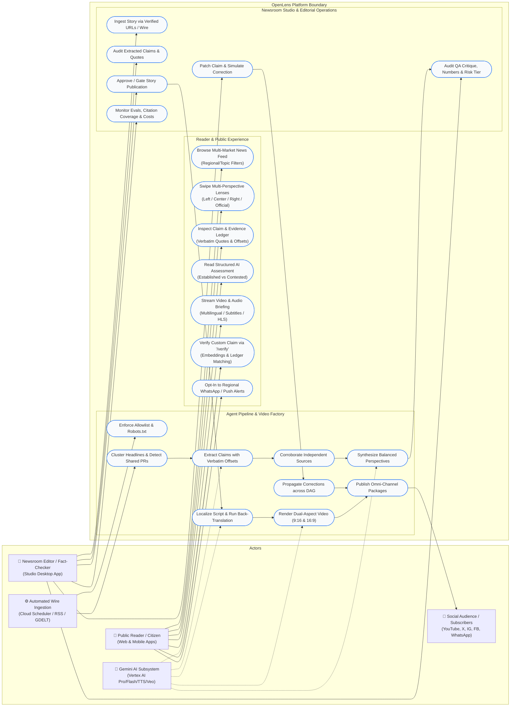
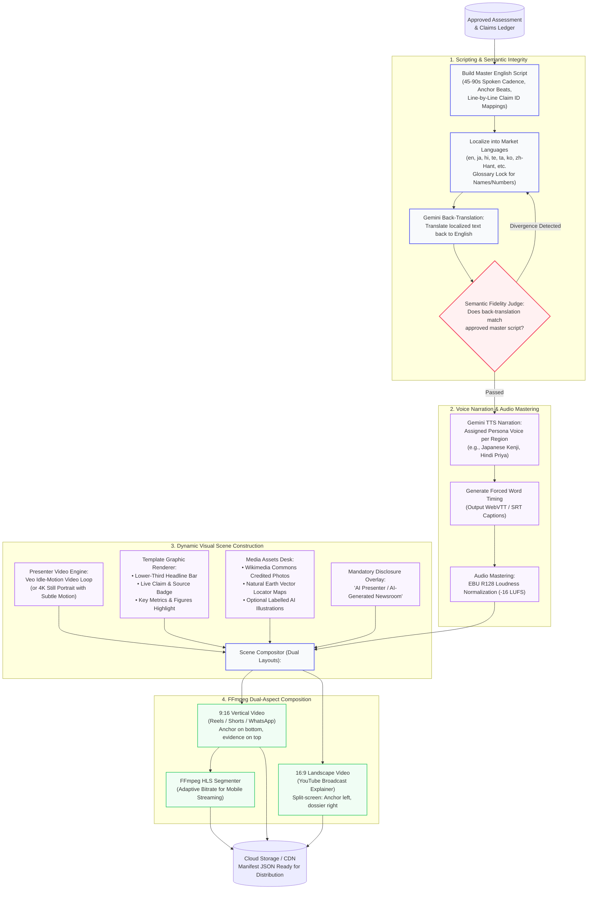
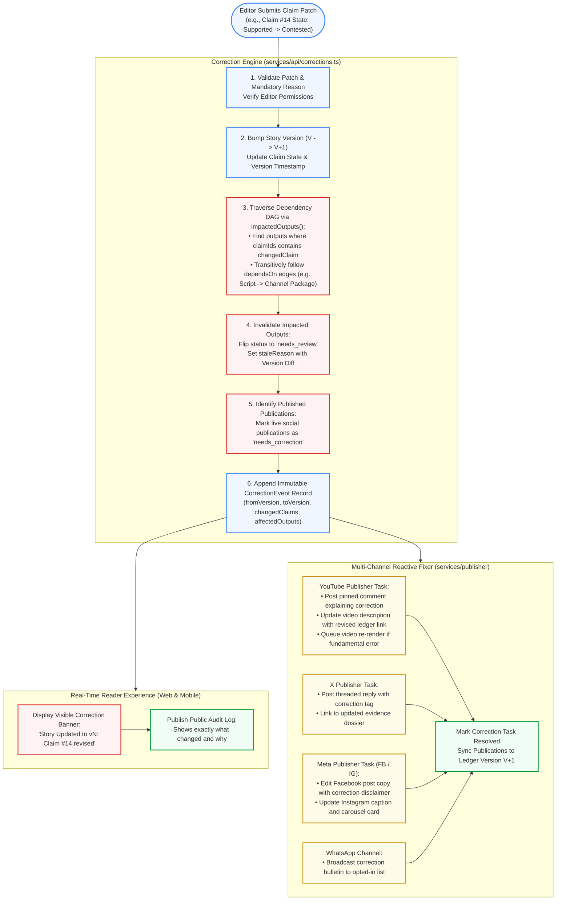
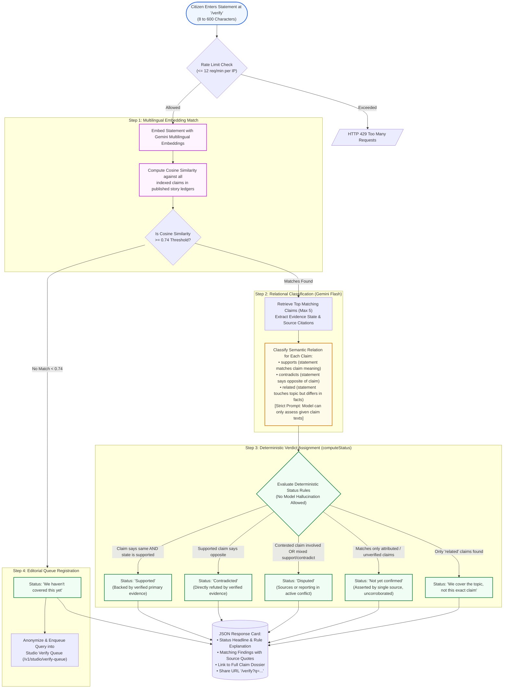

# OpenLens: Process Flow & Use-Case Diagrams Specification

> **OpenLens: The AI Media House That Shows Its Work**  
> Technical Architecture & Operational Process Blueprint for AI Builder Cup 2026.

---

## 1. Executive Overview

OpenLens transforms raw news and primary documents across the Asia-Pacific (JAPAC) region into verifiable, multi-perspective, and multilingual multimedia experiences. Unlike traditional black-box AI summarizers, OpenLens structures all reporting around a reviewed, deterministic **Claim & Evidence Ledger**.

This document specifies the system's operational behaviors, actor interactions, agent pipelines, video rendering workflows, and correction propagation mechanics via **UML Use-Case Diagrams** and **Process Flow Diagrams**.

---

## 2. UML Use-Case Diagrams & Specifications

### 2.1 System Use-Case Diagram

---

### 2.2 Actor Characterization

| Actor | Type | Description | Primary Interfaces |
|---|---|---|---|
| **Public Reader / Citizen** | Human (End User) | Consumes balanced reporting, scrutinizes evidence trails, listens/watches in their native tongue, and queries claims. | Next.js PWA (`apps/web`), Expo Mobile App (`apps/mobile` iOS & Android). |
| **Newsroom Editor / Fact-Checker** | Human (Privileged) | Supervises news generation, reviews risk classifications, validates claims, gates publication, and executes transparent corrections. | OpenLens Studio Desktop UI (`/studio`), Studio API (`services/api`). |
| **Automated Wire Ingestion Worker** | Automated System | Runs on Cloud Scheduler (10–15 min frequency) to discover breaking news from allowlisted RSS/Atom feeds and GDELT triggers. | Cloud Scheduler, Cloud Tasks, Ingest Runner (`services/api/src/ingest.ts`). |
| **AI Subsystem (Gemini & Vertex AI)** | External AI Service | Provides reasoning, multimodal extraction, Search grounding, TTS voices, and Veo idle-motion visual synthesis. | Google Cloud Vertex AI SDK, Gemini 1.5/2.0 APIs. |
| **Channel Platforms / Social Audience** | External Services / Users | External distribution channels consuming validated video packages, threads, and broadcast templates. | YouTube Data API v3, X API v2, Instagram Graph API, Facebook Pages API, WhatsApp Cloud API. |

---

### 2.3 Key Use-Case Specifications

#### UC-01: Inspect Claim & Evidence Ledger
- **Primary Actor:** Public Reader / Citizen.
- **Preconditions:** Story is published (`status: "published" | "corrected"`).
- **Trigger:** Reader taps on an assessment sentence or opens the "Evidence Dossier" tab.
- **Main Flow:**
  1. System displays all underlying atomic claims linked to the selected sentence.
  2. For each claim, system displays its assigned evidence state (`supported`, `contested`, `attributed`, `unverified`).
  3. System renders verbatim source excerpts highlighted with exact character offsets from the primary document or reporting outlet.
  4. System shows the source's political/editorial framing basis derived from documented tables.
- **Postconditions:** Reader verifies factual claims directly against original documentation without algorithmic bias.

#### UC-02: Human-in-the-Loop Publication Gating
- **Primary Actor:** Newsroom Editor.
- **Preconditions:** Agent pipeline has completed `claims`, `corroborate`, `lenses`, `research`, `synthesize`, and `qa` stages.
- **Trigger:** Editor opens the Studio Queue for an `in_review` story.
- **Main Flow:**
  1. System presents the story summary, risk-tier classification (`low` vs `sensitive`), and automated QA flags.
  2. If the story has sensitive topics (elections, legal disputes, casualties), publication is locked pending explicit sign-off.
  3. Editor inspects deterministic citation coverage (enforcing $\ge 95\%$) and number/entity verification diffs.
  4. Editor clicks **"Approve Story"**.
  5. System unlocks downstream script generation, localization, video rendering, and multi-channel publication.
- **Alternate Flow (Flagged Hallucination / Unsupported Claim):**
  - Editor rejects or edits the claim; system forces re-synthesis before publication can occur.

#### UC-03: Reactive Correction Propagation
- **Primary Actor:** Newsroom Editor.
- **Preconditions:** Story has been published to Web, Mobile, YouTube, and Social Channels.
- **Trigger:** A source updates its reporting, a factual dispute arises, or an editor submits a claim patch (`POST /v1/studio/story/:id/claim/:claimId`).
- **Main Flow:**
  1. Editor updates claim text or flips evidence state (e.g., `supported` $\rightarrow$ `contested`) with a mandatory audit reason.
  2. System increments story ledger version ($V \rightarrow V+1$).
  3. Correction Engine traverses the dependency Directed Acyclic Graph (DAG) using `impactedOutputs(outputs, [claimId])`.
  4. All affected scripts, channel packages, and video outputs are immediately marked `needs_review` with a stale reason.
  5. Live social publications linked to affected outputs are flagged `needs_correction`.
  6. Reader Web and Mobile apps instantly display a prominent **Correction Notice Banner** indicating which claim changed and why.
  7. Channel publisher enqueues corrective actions (pinned comment update on YouTube, correction thread on X, revised caption on Facebook).
- **Postconditions:** Transparent, auditable correction trail is published without manual cross-platform tracking.

#### UC-04: Citizen Claim Verification ("Verify This")
- **Primary Actor:** Public Reader / Citizen.
- **Preconditions:** At least one story ledger is indexed in Firestore / vector store.
- **Trigger:** User submits a 8–600 character statement at `/verify`.
- **Main Flow:**
  1. System generates a multilingual embedding for the user's statement via Gemini Embeddings.
  2. System computes cosine similarity across all claims in published ledgers, filtering by threshold ($\ge 0.74$).
  3. Top matching claims are sent to Gemini with strict instructions to evaluate solely against the provided claim texts (`supports`, `contradicts`, or `related`).
  4. Deterministic decision engine computes the verdict: `Supported`, `Contradicted`, `Disputed`, `Not yet confirmed`, `Topic covered but not claim`, or `Uncovered`.
  5. System renders an evidence card showing matching claims, source outlets, and direct ledger links.
- **Alternate Flow (Uncovered Statement):**
  - Statement matches no published claims; system registers the statement anonymously into the editorial research queue (`/studio/verify-queue`).

---

## 3. Process Flow Diagrams

### 3.1 End-to-End System Process Flow (Wire-to-Publish)

This flowchart illustrates the complete lifecycle of news content in OpenLens, from initial discovery through multi-agent analysis, editorial approval, media synthesis, and reader consumption.

```mermaid
flowchart TD
    %% Styling Classes
    classDef trigger fill:#e0f2fe,stroke:#0284c7,stroke-width:2px;
    classDef agent fill:#fef3c7,stroke:#d97706,stroke-width:2px;
    classDef data fill:#f1f5f9,stroke:#475569,stroke-width:1.5px;
    classDef gate fill:#fee2e2,stroke:#dc2626,stroke-width:2px;
    classDef media fill:#f3e8ff,stroke:#9333ea,stroke-width:2px;
    classDef pub fill:#dcfce7,stroke:#16a34a,stroke-width:2px;

    %% Ingestion Phase
    subgraph Phase1 ["1. Ingestion & Discovery"]
        T1(["Cloud Scheduler\n(10-15 min cron)"]):::trigger
        T2(["Manual Desk Intake\n('npm run story' / 'npm run intake')"]):::trigger
        
        P1_Poll["Feed Poller\n(RSS / Atom / GDELT Signals)"]
        P1_Allow["Allowlist & Robots.txt Check\n(Rights & License Validation)"]
        P1_Fetch["Full-Text Document Extraction\n(HTML Readability & Gemini PDF Parser)"]
        P1_Cluster["Multilingual Event Clustering\n(Embeddings & Deduplication)"]
        D_Source[("Source Records\n& Content Hash")]:::data

        T1 --> P1_Poll
        T2 --> P1_Allow
        P1_Poll --> P1_Allow
        P1_Allow -->|Verified Source Only| P1_Fetch
        P1_Allow -->|Unlisted Domain| P1_Reject[/"Drop & Log Ingestion Rejection"/]
        P1_Fetch --> P1_Cluster
        P1_Cluster --> D_Source
    end

    %% Agent Pipeline Phase
    subgraph Phase2 ["2. Multi-Agent Intelligence Pipeline (Google ADK / Vertex AI)"]
        A_Claims["Stage 1: Claims Extraction\n(Atomic Claims + Exact Quote Offsets)"]:::agent
        A_Corrob["Stage 2: Deterministic Corroboration\n(Independent Root Counting & Contradictions)"]:::agent
        A_Lenses["Stage 3: Lens & Framing Analysis\n(Documented Rating Tables + Neutral Summaries)"]:::agent
        A_Research["Stage 4: Grounded Research\n(Google Search Grounding + Official Context)"]:::agent
        A_Synth["Stage 5: Editorial Synthesis\n(Balanced Assessment: Established / Contested)"]:::agent
        A_QA["Stage 6: Multi-Critic QA & Risk Tiering\n(>=95% Citation Check, Entity Diff, Hallucination Gate)"]:::agent
        
        D_Ledger[("Claim & Evidence Ledger\n(Firestore State)")]:::data

        D_Source --> A_Claims
        A_Claims -->|Verbatim Match Verified| A_Corrob
        A_Claims -.->|Unmatched Quote| DropQuote[/"Drop Claim"/]
        A_Corrob --> D_Ledger
        D_Ledger --> A_Lenses
        D_Ledger --> A_Research
        A_Lenses & A_Research --> A_Synth
        A_Synth --> A_QA
    end

    %% Editorial Gate Phase
    subgraph Phase3 ["3. Editorial Gate & Human-in-the-Loop"]
        G_Risk{"Evaluate Risk Tier\n& QA Flags"}:::gate
        G_Editor{"Editor Studio Approval\n(Review Diff & Numbers)"}:::gate
        
        A_QA --> G_Risk
        G_Risk -->|Sensitive Risk / QA Flags| G_Editor
        G_Risk -->|Low Risk & Auto-Publish Enabled| G_AutoApproved[/"Auto-Approve Low Risk"/]:::pub
        G_Editor -->|Approved| G_Proceed[/"Proceed to Production"/]:::pub
        G_Editor -->|Rejected / Edited| E_Patch[/"Edit Claim / Re-synthesize"/]
        E_Patch --> A_Synth
        G_AutoApproved --> G_Proceed
    end

    %% Production & Media Factory Phase
    subgraph Phase4 ["4. Localization & Media Factory (services/media-worker)"]
        M_Script["Stage 7: Base Script Assembly\n(Claim IDs Mapped to Spoken Lines)"]:::agent
        M_Localize["Stage 8: Multilingual Localization\n(13 JAPAC Languages + Glossary Lock)"]:::agent
        M_BackTrans{"Back-Translation Judge Check\n(Gemini Verifies Semantic Fidelity)"}:::gate
        M_TTS["Gemini TTS Engine\n(Voice Persona per Market / Regional Language)"]:::media
        M_Visuals["Scene Assembler\n(Veo Idle Presenter, Cards, Maps, Disclosures)"]:::media
        M_FFmpeg["FFmpeg Render Engine\n(9:16 Vertical & 16:9 Landscape + HLS + VTT)"]:::media
        
        D_Media[("Rendered Media Assets\n(Cloud Storage Bucket)")]:::data

        G_Proceed --> M_Script
        M_Script --> M_Localize
        M_Localize --> M_BackTrans
        M_BackTrans -->|Pass| M_TTS
        M_BackTrans -->|Fidelity Failure| M_Localize
        M_TTS --> M_Visuals
        M_Visuals --> M_FFmpeg
        M_FFmpeg --> D_Media
    end

    %% Publishing & Distribution Phase
    subgraph Phase5 ["5. Omni-Channel Publishing & Consumer Delivery"]
        P_Package["Stage 9: Channel Packaging\n(YouTube Meta, X Threads, Reels, WhatsApp)"]:::agent
        P_Publish["Publisher Service\n(services/publisher)"]:::pub
        
        Pub_Web["OpenLens Web PWA\n(Next.js on Cloud Run/Vercel)"]:::pub
        Pub_Mobile["OpenLens Native Mobile\n(Expo iOS & Android)"]:::pub
        Pub_YT["YouTube Channels\n(Global, National, Regional)"]:::pub
        Pub_Social["Social Networks\n(X, Instagram Reels, Facebook)"]:::pub
        Pub_WA["WhatsApp Cloud API\n(Opt-in Regional Subscribers)"]:::pub

        D_Media & G_Proceed --> P_Package
        P_Package --> P_Publish
        
        P_Publish --> Pub_Web
        P_Publish --> Pub_Mobile
        P_Publish --> Pub_YT
        P_Publish --> Pub_Social
        P_Publish --> Pub_WA
    end

    %% Citizen Interaction
    subgraph Phase6 ["6. Citizen Experience & Verification"]
        User_Read["Reader Explores Story Lenses\n& Taps Evidence Quotes"]
        User_FactCheck["Reader Fact-Checks Custom Statement\nat '/verify'"]
        
        Pub_Web & Pub_Mobile --> User_Read
        User_FactCheck -->|Embed & Match| D_Ledger
    end
```

---

### 3.2 Detailed Agentic Story Processing Pipeline

This diagram zooms into the **10-Stage Agent Execution Pipeline** managed by the Google ADK and Gemini reasoning engine.

```mermaid
flowchart TD
    classDef stage fill:#f8fafc,stroke:#2563eb,stroke-width:2px;
    classDef check fill:#fef2f2,stroke:#ef4444,stroke-width:1.5px;
    classDef store fill:#ecfdf5,stroke:#059669,stroke-width:1.5px;

    Start([Input: Allowlisted URLs / Wire Batch]) --> S1

    subgraph S1 ["Stage 1: Claim Extraction (Gemini Flash)"]
        S1_Run["Extract Atomic Claims\nExtract Direct Speaker Attribution\nCapture Verbatim Supporting Quote"]:::stage
        S1_Val{"Deterministic Verifier:\nDoes quoted text exist\nverbatim in raw source?"}:::check
        S1_Pass["Save Validated Claims\nRecord Precise Character Offsets"]:::store
        S1_Fail["Drop Unmatched Claim\nIncrement droppedClaims Counter"]
        
        S1_Run --> S1_Val
        S1_Val -->|Yes| S1_Pass
        S1_Val -->|No| S1_Fail
    end

    S1_Pass --> S2

    subgraph S2 ["Stage 2: Deterministic Corroboration Engine"]
        S2_Root["Detect Shared Press Releases & Syndication\n(Cluster by Content Hash / URL Domain)"]:::stage
        S2_Calc["Count Independent Root Sources\nIdentify Contradictory Assertions"]:::stage
        S2_Assign["Assign Rule-Based Evidence State:\n• supported (>=2 independent roots)\n• attributed (single source assertion)\n• contested (conflicting reports)\n• unverified (insufficient backing)"]:::store
        
        S2_Root --> S2_Calc --> S2_Assign
    end

    S2_Assign --> S3 & S4

    subgraph S3 ["Stage 3: Multi-Lens Perspective Analysis"]
        S3_Table["Lookup Source Rating in Static Allowlist\n(Left / Center / Right / Unrated)"]:::stage
        S3_Frame["Generate Framing Summaries\n(Strictly Disclosed as 'Model-Generated')"]:::stage
        S3_Lanes["Synthesize Perspectives into 3 Contrast Lanes"]:::store
        
        S3_Table --> S3_Frame --> S3_Lanes
    end

    subgraph S4 ["Stage 4: Grounded Official Research (Gemini Pro)"]
        S4_Search["Google Search Grounding & Official Portals\n(Targeting Acts, Court Orders, Gazette Releases)"]:::stage
        S4_Context["Structure Legal & Official Context Items\nConstruct Verified Chronological Timeline"]:::store
        
        S4_Search --> S4_Context
    end

    S3_Lanes & S4_Context --> S5

    subgraph S5 ["Stage 5: Editorial Synthesis (Gemini Pro Reasoning)"]
        S5_Draft["Draft Neutral Headline & Overview\nPartition Findings into Sections:\n• established (citations MUST be 'supported')\n• attributed (cites primary statements)\n• contested (lays out explicit disagreement)\n• unknown & would_change (critical blindspots)"]:::stage
        S5_Lock["Enforce Strict Citation Schema:\nEvery factual sentence MUST cite claimIds[]"]:::store
        
        S5_Draft --> S5_Lock
    end

    S5_Lock --> S6

    subgraph S6 ["Stage 6: Multi-Critic QA & Risk Classification"]
        S6_C1{"Deterministic Citation Check:\nAre >=95% of factual\nsentences cited?"}:::check
        S6_C2{"NER & Number Diff:\nDo entities, numbers, and dates\nmatch the Ledger exactly?"}:::check
        S6_C3["Gemini Critic:\nDetect Subtle Bias or Unbacked Inferences"]:::stage
        S6_Risk["Classify Story Risk Tier:\n• Low: Routine civic/tech updates\n• Sensitive: Politics, conflict, legal accusations"]:::store
        
        S6_C1 -->|Pass| S6_C2
        S6_C2 -->|Pass| S6_C3 --> S6_Risk
        S6_C1 -->|Fail <95%| S5_Draft
        S6_C2 -->|Mismatch| S5_Draft
    end

    S6_Risk --> End([Ready for Editorial Gate / Script Generation])
```

---

### 3.3 Multilingual Video Factory Architecture & Pipeline

This diagram shows how OpenLens creates broadcast-ready news videos with forced subtitles and AI disclosures across two aspect ratios (9:16 and 16:9).

---

### 3.4 Reactive Correction Propagation Engine Flow

This diagram illustrates how OpenLens guarantees verifiable transparency by traversing the output dependency DAG when an editor updates a claim.

---

### 3.5 "Verify This" Citizen Fact-Checking Process Flow

This flowchart diagrams the `/verify` subsystem, where a citizen enters an arbitrary claim and the platform checks it against indexed ledgers using vector similarity and rule-based logic.

---

## 4. Architectural Traceability Matrix

This table maps the functional components in the process diagrams to the specific code packages and services within the repository.

| Diagram Subsystem | Workspace Package | Key Modules / Source Files | Core Dependencies |
|---|---|---|---|
| **Schemas & Data Contracts** | `packages/schemas` | [`ledger.ts`](packages/schemas/src/ledger.ts), [`outputs.ts`](packages/schemas/src/outputs.ts), [`ops.ts`](packages/schemas/src/ops.ts) | Zod, TypeScript |
| **Model Registry & Config** | `packages/config` | `japac.ts`, `models.ts`, `channels.ts` | Shared Config |
| **Ingestion & Discovery** | `services/agents`, `services/api` | [`intake.ts`](services/agents/src/intake.ts), [`discovery.ts`](services/agents/src/discovery.ts), [`ingest.ts`](services/api/src/ingest.ts), [`robots.ts`](services/agents/src/robots.ts) | Cheerio, GDELT, RSS-Parser |
| **Claims & Corroboration** | `services/agents` | [`claims.ts`](services/agents/src/claims.ts), [`corroborate.ts`](services/agents/src/corroborate.ts) | Gemini 1.5/2.0 Flash, Regex Verifier |
| **Synthesis & QA Critique** | `services/agents` | [`synthesis.ts`](services/agents/src/synthesis.ts), [`qa.ts`](services/agents/src/qa.ts), [`research.ts`](services/agents/src/research.ts) | Gemini Pro (Reasoning + Search Grounding) |
| **Scripting & Localization** | `services/agents` | [`script.ts`](services/agents/src/script.ts), [`channels.ts`](services/agents/src/channels.ts) | Gemini Pro, Back-Translation Judge |
| **Video Factory (Rendering)** | `services/media-worker` | [`render.ts`](services/media-worker/src/render.ts), [`tts.ts`](services/media-worker/src/tts.ts), [`scenes.ts`](services/media-worker/src/scenes.ts), [`beats.ts`](services/media-worker/src/beats.ts) | Vertex AI Gemini TTS, Veo, FFmpeg, Canvas |
| **Correction Engine** | `services/api` | [`corrections.ts`](services/api/src/corrections.ts), [`store.ts`](services/api/src/store.ts) | Firestore, Graph Traversal |
| **Omni-Channel Publisher** | `services/publisher` | [`base.ts`](services/publisher/src/base.ts), `channels/youtube.ts`, `channels/meta.ts`, `channels/x.ts` | YouTube Data API, Meta Graph API, X API |
| **Citizen Verification** | `services/api` | [`verify.ts`](services/api/src/verify.ts) | Gemini Multilingual Embeddings, Vector Search |
| **Reader Web PWA** | `apps/web` | `app/story/[id]/page.tsx`, `components/verify/verify-box.tsx`, `components/ledger/` | Next.js 14, Tailwind CSS, Lucide Icons |
| **Reader Mobile App** | `apps/mobile` | `app/story/[id].tsx`, `components/LensPager.tsx` | Expo SDK, React Native Reanimated, Expo Video |
