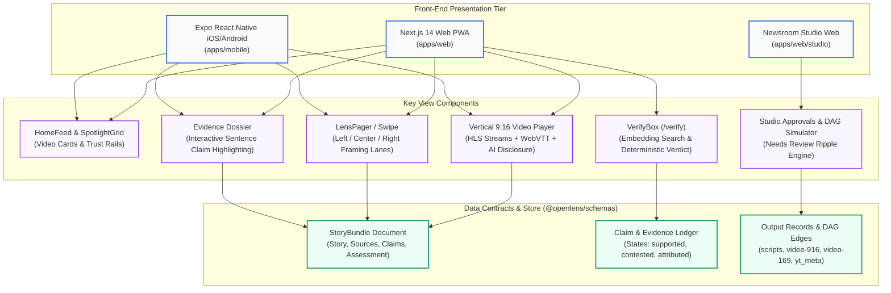

# Slide: Wireframes & Mock Diagrams of the Proposed Solution

> **OpenLens: The AI Media House That Shows Its Work**  
> AI Builder Cup 2026 · Pitch Deck Slide Specification

---

## 1. Slide Metadata & Layout Plan

- **Slide Title:** User Experience & Interface Architecture: Showing the Work
- **Subtitle:** Evidence-First, Multi-Perspective UI across Native Mobile, Web PWA, and Newsroom Studio
- **Slide Objective:** Prove feasibility and UX innovation (10% UX + 25% Innovation rubric) by demonstrating that OpenLens is not a theoretical model prompt, but a deployed, video-first, auditable news application.
- **Recommended 3-Column Visual Layout:**
  - **Left Column:** Mobile Reader App (Vertical video, lens-swipe pager, bottom-sheet evidence).
  - **Center Column:** Web PWA Story Screen & Evidence Dossier (Side-by-side 9:16 player + verbatim quote highlights).
  - **Right Column:** Newsroom Studio & "Verify This" Citizen Engine (Editorial gate, DAG correction rippling, vector claim matcher).

---

## 2. High-Fidelity UI Wireframes

### Screen 1: Mobile Reader App (Expo Native iOS & Android)
*Experience Pattern: Vertical snap-scroll feed with video-first delivery, multi-perspective lens switcher, and interactive evidence chips.*

```text
┌───────────────────────────────────────────────┐
│  09:41 📶 5G                           100% 🔋 │
│  OPENLENS                     [APAC ▾]  [ 🔍 ]│
├───────────────────────────────────────────────┤
│  ┌─────────────────────────────────────────┐  │
│  │ 🏷️ JAPAN · 2h ago       [AI Presenter]  │  │
│  │                                         │  │
│  │          [ VEO IDLE PRESENTER ]         │  │
│  │        Fictional Anchor: Kenji          │  │
│  │                                         │  │
│  │  ─────────────────────────────────────  │  │
│  │  "Tokyo Metro raises basic fare to ¥200"│  │
│  │  [LIVE SUBTITLES: First hike in 28 yrs] │  │
│  │  🔊 0:48 / 1:12              [ 9:16 ]   │  │
│  └─────────────────────────────────────────┘  │
│   Evidence: ● 12 Supported  ▲ 2 Contested     │
│   Languages: [JA: 日本語] [EN: English] [HI]   │
├───────────────────────────────────────────────┤
│  HOW OUTLETS FRAMED IT (SWIPE PERSPECTIVE)    │
│  ┌──────────────┐ ┌──────────────┐ ┌────────┐ │
│  │ ◀ LEFT LANE  │ │★ CENTER LANE │ │ RIGHT ▶│ │
│  │ Asahi Shimbun│ │  Nikkei / NHK│ │ Sankei │ │
│  │ Focus on     │ │ Focus on     │ │ Focus  │ │
│  │ household    │ │ capital      │ │ on debt│ │
│  │ burden &     │ │ investments  │ │ repay- │ │
│  │ inflation    │ │ & safety     │ │ ment   │ │
│  └──────────────┘ └──────────────┘ └────────┘ │
├───────────────────────────────────────────────┤
│  WHAT WE KNOW (STRUCTURED AI ASSESSMENT)      │
│  • Established: Base fare jumps from ¥180 to  │
│    ¥200 effective March 2026 [Claim #1] [C#2] │
│  • Contested: Projected ridership recovery    │
│    rates diverge by 14% [Claim #8]            │
├───────────────────────────────────────────────┤
│  [ 📑 Open Research Dossier (14 Claims) ]     │
├───────────────────────────────────────────────┤
│  [ 🏠 Feed ]    [ ⚡ Watch ]    [ ✓ Verify ]   │
└───────────────────────────────────────────────┘
```

---

### Screen 2: Web Story Screen & Deep-Dive Dossier (Next.js PWA)
*Experience Pattern: Side-by-side synchronized view. As the video plays or the user reads the assessment, clicking any claim highlights the verbatim source quote with exact character offsets.*

```text
┌────────────────────────────────────────────────────────────────────────────────────────┐
│  OPENLENS   Videos  Explainers  The Wire  /verify                   [Tokyo Edition ▾] │
├───────────────────────────────────────────┬────────────────────────────────────────────┤
│  VERTICAL BROADCAST PLAYER (9:16)         │  STORY ASSESSMENT & DOSSIER                │
│  ┌─────────────────────────────────────┐  │  JAPAN · TRANSPORT & CIVIC · 14 MIN READ   │
│  │ [AI Presenter Disclosure: Kenji]   │  │                                            │
│  │                                     │  │  Tokyo Metro Approves First Basic Fare     │
│  │                                     │  │  Revision in 28 Years                      │
│  │                                     │  │                                            │
│  │                                     │  │  [✓ 12 Supported] [▲ 2 Contested] [Share]  │
│  │                                     │  ├────────────────────────────────────────────┤
│  │                                     │  │  WHAT WE KNOW (SYNTHESIS)                  │
│  │                                     │  │  The Ministry of Land, Infrastructure, and │
│  │                                     │  │  Transport approved Tokyo Metro's revision │
│  │                                     │  │  application on Friday [Claim #1]. The    │
│  │                                     │  │  operator cites ¥52B in barrier-free track │
│  │                                     │  │  upgrades [Claim #4].                      │
│  │                                     │  ├────────────────────────────────────────────┤
│  │  Tokyo Metro fare revision          │  │  VERBATIM EVIDENCE DOSSIER (CLAIM #4)      │
│  │  Line 4: "¥52B earmarked for lifts" │  │  ┌──────────────────────────────────────┐ │
│  │  [CC: WebVTT Subtitles Active]      │  │  │ Claim #4: "¥52B capital expenditure   │ │
│  │  ▶ 0:24 / 0:58           ⚙ 1080p ⛶  │  │  │ State: SUPPORTED (3 independent roots)│ │
│  └─────────────────────────────────────┘  │  │ Attributed to: Tokyo Metro Filing    │ │
│  Available Languages:                     │  │ ──────────────────────────────────── │ │
│  (● JA: 日本語)  (EN: English)  (KO: 한국어)│  │ Source: MLIT Official Gazette Release│ │
│                                           │  │ "東京メトロは、バリアフリー設備整備の │ │
│  [ ⬇ Download 16:9 Explainer MP4 ]         │  │  ため520億円を投資する計画を申請..."  │ │
│  [ 📱 Scan QR for Mobile Verification ]    │  │  [Exact Char Offsets: 1,420 – 1,488] │ │
│                                           │  │  License: Open Government Data v2.1 │ │
│                                           │  └──────────────────────────────────────┘ │
└───────────────────────────────────────────┴────────────────────────────────────────────┘
```

---

### Screen 3: Newsroom Studio & Correction Propagation Simulator
*Experience Pattern: Desktop-first editorial control center. Real-time Gemini agent pipeline monitor, deterministic QA gate, and live DAG correction engine.*

```text
┌────────────────────────────────────────────────────────────────────────────────────────┐
│  OPENLENS STUDIO   Queue (3)   Wire Monitor   Evals Panel   Audit Log     [Editor: Alex]│
├────────────────────────────────────────────────────────────────────────────────────────┤
│  STORY: jp-fare-2026 · Tokyo Metro Revision            [STATUS: IN_REVIEW] [RISK: LOW]  │
├───────────────────────────────────────────┬────────────────────────────────────────────┤
│  AI PIPELINE STAGES                       │  DETERMINISTIC EVALS & SAFETY GATE         │
│  [✓] 1. Intake & Deduplication            │  • Citation Coverage:  97.4% [PASS >=95%]  │
│  [✓] 2. Atomic Claim Extraction (14)      │  • Entity & Number Diff: 0 discrepancies   │
│  [✓] 3. Corroboration & Independence      │  • Back-Translation Score: 0.94 / 1.00     │
│  [✓] 4. Multi-Lens Framing Analysis       │  • Dropped Unverified Quotes: 2 claims     │
│  [✓] 5. Grounded Research & Timeline      │  • Risk Tier: Low (Civic Infrastructure)   │
│  [✓] 6. Multi-Critic QA (0 Hallucinations)│                                            │
│  [✓] 7. Script Localization (13 JAPAC)    │  [ ✔ APPROVE STORY FOR MULTI-CHANNEL PUB ] │
│  [◷] 8. Media Worker (Dual-Aspect Render) │                                            │
├───────────────────────────────────────────┴────────────────────────────────────────────┤
│  REACTIVE CORRECTION SIMULATOR (DEPENDENCY GRAPH TRAVERSAL)                            │
│  Patch Claim: [ Claim #8: Ridership projection ▾ ]  New State: [ Contested ▾ ]         │
│  Reason: "Nikkei published revised forecast table questioning post-COVID baseline"    │
│                                                                                        │
│  CASCADE PREVIEW: Ledger Version 1 ➔ Version 2                                         │
│  ┌────────────────┐    ┌────────────────────┐    ┌───────────────────────────────────┐ │
│  │ Claim #8       │ ➔  │ Script Lines 4 & 5 │ ➔  │ yt-national-ja (needs_correction)│ │
│  │ (Contested)    │    │ (needs_review)     │    │ x-thread-ja    (needs_correction)│ │
│  │                │    │                    │    │ Reel-916-ja    (needs_review)    │ │
│  └────────────────┘    └────────────────────┘    └───────────────────────────────────┘ │
│  [ ⚡ Commit Patch & Auto-Dispatch Correction Tasks to YouTube / Meta / X / WhatsApp ]   │
└────────────────────────────────────────────────────────────────────────────────────────┘
```

---

### Screen 4: Citizen Fact-Checking Engine ("Verify This" — `/verify`)
*Experience Pattern: Transparent public query box. Citizens paste any breaking headline or rumor to test it against verified, indexed Claim Ledgers.*

```text
┌────────────────────────────────────────────────────────────────────────────────────────┐
│  OPENLENS                                              Videos   Explainers   [Verify]  │
├────────────────────────────────────────────────────────────────────────────────────────┤
│                                                                                        │
│                          VERIFY WITH OPENLENS                                          │
│         Check any claim or news link against our reviewed evidence ledgers             │
│                                                                                        │
│  ┌──────────────────────────────────────────────────────────────────────────┐         │
│  │ Tokyo Metro subway fares are doubling next month                          │ [Verify]│
│  └──────────────────────────────────────────────────────────────────────────┘         │
│                                                                                        │
│  VERDICT: CONTRADICTED BY OFFICIAL FILING                                              │
│  Status: [ CONTRADICTED ]  ·  Matching Method: Multilingual Semantic Embedding (0.88)  │
│                                                                                        │
│  Explanation:                                                                          │
│  Tokyo Metro's approved fare revision increases the basic fare from ¥180 to ¥200       │
│  (an 11.1% adjustment), not a 100% doubling. The change takes effect in March 2026.   │
│                                                                                        │
│  MATCHING EVIDENCE FROM LEDGER:                                                        │
│  ┌──────────────────────────────────────────────────────────────────────────────────┐  │
│  │ 🔴 Says the opposite  ·  [SUPPORTED CLAIM]                                        │  │
│  │ "The adult basic fare will increase by ¥20, from ¥180 to ¥200."                  │  │
│  │ Sources: Ministry of Transport Gazette · Tokyo Metro IR Release                  │  │
│  │ [ Open Story: Tokyo Metro Fare Revision ➔ ]          [ 🔗 Share Verified Check ]  │  │
│  └──────────────────────────────────────────────────────────────────────────────────┘  │
│                                                                                        │
└────────────────────────────────────────────────────────────────────────────────────────┘
```

---

## 3. UI Component Hierarchy & Architecture



---

## 4. Key Design Decisions & Innovation Callouts

1. **Lens Swipe vs. Truth Meter**:
   - Competing fact-checkers attempt to rank stories on a single linear "truthfulness" dial, which introduces model bias.
   - OpenLens presents a **horizontal perspective carousel** showing how different editorial outlets framed the identical event, supported by the objective Claim Ledger below.
2. **Deterministic Highlight Offsets**:
   - Tapping any claim instantly highlights the exact source document sentence using immutable character offsets (`start: 1420, end: 1488`).
3. **Mandatory AI Presenter & Content Disclosure**:
   - Every video frame carries a non-removable on-screen disclosure label (`"AI Presenter: Kenji · Disclosed Synthetic Voice"`), guaranteeing compliance with Google AI Safety guidelines and YouTube's `containsSyntheticMedia` standards.
4. **Permanent Public Correction Trail**:
   - In standard media, corrections are silent edits or buried footers. In OpenLens, version changes trigger high-visibility banners (`"Story Updated to v2: Claim #8 Contested"`), linking directly to the reason for modification.

---

## 5. Slide Presenter Script (30–45s Pitch Track)

> *"On screen are the wireframes of OpenLens in action across mobile, web, and our newsroom studio.*  
>  
> *On the left, our mobile reader delivers a modern, video-first news feed. Viewers watch broadcast-quality 9:16 videos narrated by disclosed AI personas in 13 Asia-Pacific languages, with an interactive lens switcher that reveals diverse editorial framings without bias.*  
>  
> *In the center, our web dossier shows how OpenLens 'shows its work': every sentence is linked to atomic claims with verbatim character-offset quotes from primary sources.*  
>  
> *On the right, our Newsroom Studio enforces a strict human-in-the-loop gate before publishing, alongside our reactive correction engine that ripples updates across YouTube, social channels, and web in real-time when facts evolve.*  
>  
> *This turns opaque generative AI into an open, auditable glass box."*
